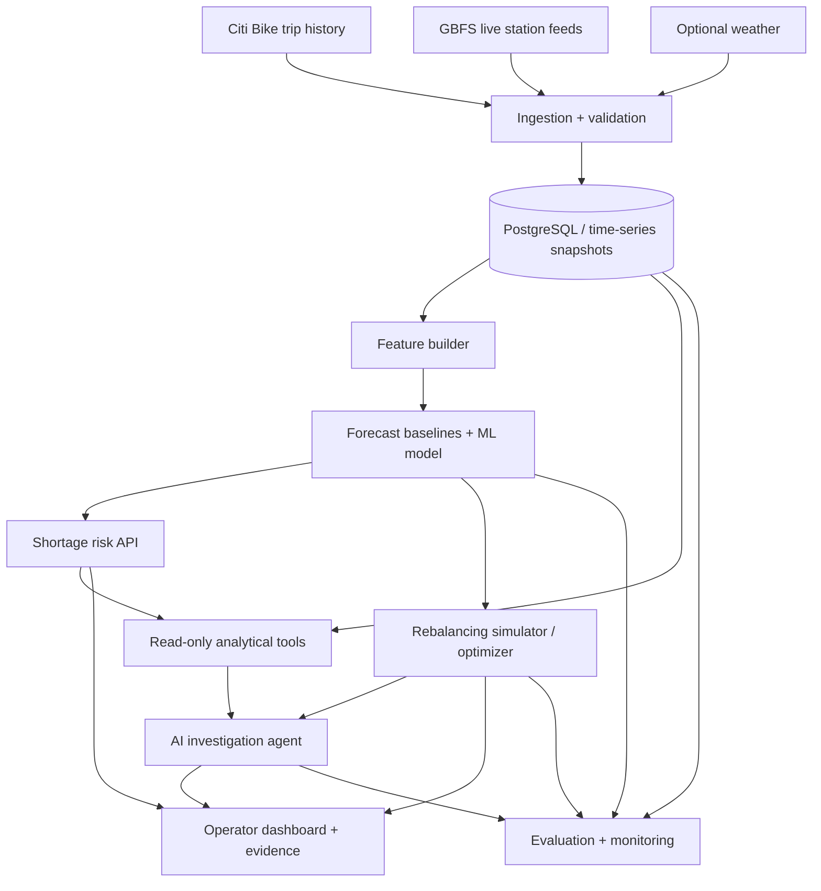

# Citi Bike: Agentic Fleet Forecasting & Optimization Engine

> [!abstract] Project thesis
> Build an **independent, research-driven mobility operations system** using published Citi Bike trip records and live station-status feeds. Predict stations at risk of bike/dock shortages, investigate operational anomalies with an evidence-grounded AI agent, and **simulate** fleet-rebalancing recommendations under explicit constraints. Treat model evaluation as a first-class product feature.

> [!important] Independent project; not an official Citi Bike product
> This is a portfolio/research project using public data, **not** a Citi Bike partnership or operational deployment. Do not imply endorsement or access to internal dispatch, inventory, rider requests, or staff intervention records. The provider's [data-sharing policy](https://citibikenyc.com/data-sharing-policy) restricts certain data uses and the use of its trademarks/logos without permission. Review the policy before public release; avoid branded logos and seek appropriate permission for public-facing trademark use if needed.

## 0. Project at a glance

| Field | Plan |
|---|---|
| **Primary goal** | Demonstrate FDE skills by turning a real, ambiguous operational problem into a deployed, evaluated AI-enabled system |
| **Domain** | Bike-share station availability, demand forecasting, incident investigation, simulated rebalancing |
| **Initial scope** | 30–50 docked stations in one Manhattan area, 30-minute forecast horizon |
| **Inputs** | Citi Bike monthly trip records; GBFS station information/status; optional weather |
| **Outputs** | Station shortage-risk predictions, evidence-backed investigations, *simulated* rebalancing suggestions |
| **Main AI role** | Tool-using analyst: investigate, query, compare, explain; not invent data or directly move bikes |
| **Core non-LLM methods** | Time-series baselines, gradient-boosted trees, anomaly detection, constrained optimization |
| **Definition of success** | A live-data pipeline, honest out-of-time evaluation, reproducible simulator, tested agent, public technical case study |

### The core problem

A rider needs **an available bike at origin** and **an available dock at destination**. Station availability varies with commuting cycles, weather, local demand, and potentially operator interventions. The useful decision is not merely “How many bikes are there now?” but:

1. **What is likely to happen in the next 30 minutes?**
2. **Why is this station at risk, according to available evidence?**
3. **Which intervention would help, given limited resources?**
4. **How confident are we, and how much better is the proposal than a simple baseline?**

### FDE-style operator scenario

> “Several stations around Midtown have repeatedly run out of bikes during the morning commute. Which stations are likely to become unavailable in the next 30 minutes? Show the evidence, distinguish observations from hypotheses, and recommend how to rebalance a limited number of bikes.”

Expected response: an incident/risk summary, station-level evidence with timestamps, forecast confidence, bounded recommended moves, estimated impact *in simulation*, and assumptions that could change the result.

---

## 1. Objectives and non-goals

### Objectives

- [ ] Build reliable ingestion and storage for real station snapshots and real trip records.
- [ ] Predict **bike-empty** and **dock-full** risk over a 30-minute horizon.
- [ ] Compare simple deterministic and statistical/ML forecasting approaches.
- [ ] Create an AI investigation agent that invokes read-only analytical tools and cites evidence.
- [ ] Implement a constrained rebalancing **simulator**, not a live dispatch controller.
- [ ] Evaluate forecast quality, agent correctness, and simulated operational impact separately.
- [ ] Deploy a small, usable operations interface and publish a credible engineering write-up.

### Explicit non-goals for v1

- [ ] **Do not** attempt to control or integrate with real Citi Bike dispatch systems.
- [ ] **Do not** assume access to internal station-maintenance logs, truck routing, staffing, rider searches, or actual rebalancing moves.
- [ ] **Do not** claim that a reduction in simulated stockouts is a measured improvement to Citi Bike's live service.
- [ ] **Do not** build a giant multi-agent framework, complex SaaS billing, or authentication platform before solving the core forecasting task.
- [ ] **Do not** train a foundation model from scratch for this project.

---

## 2. Real data: source inventory and limitations

| Source | Available information | Use | What it **does not** give us |
|---|---|---|---|
| [Citi Bike trip histories](https://citibikenyc.com/system-data) | Ride start/end times, stations, ride type and related fields | Historical arrival/departure patterns, flow features, demand proxy | Failed rental attempts; direct stockout histories; internal dispatch events |
| [Citi Bike GBFS discovery](https://gbfs.citibikenyc.com/gbfs/2.3/gbfs.json) | Discover published GBFS feeds | Canonical entry point for live data | Long-term historical snapshots |
| GBFS `station_information` | Station identifiers, location, name and capacity information where supplied | Mapping, station characteristics, neighborhood selection | Perfectly immutable station metadata |
| GBFS `station_status` | Current available bikes/docks and service-status fields | Monitor availability; build a **new** time series | Historical availability before our collector starts |
| [NWS weather API](https://www.weather.gov/documentation/services-web-api) (optional) | Forecasts and recent station observations | Explain/forecast weather-sensitive demand | Full historical weather archive via recent observations endpoint |
| [Citi Bike monthly reports](https://citibikenyc.com/system-data) | Published system-level operational summaries | Domain context and plausibility checks | Detailed station-by-station truck movements |

> [!warning] Critical data distinction
> Historical trip records are **completed rides**, not all attempted rides. A station can have zero departures because nobody wanted a bike *or because no bike was available*. The live GBFS status is a current snapshot feed. **Collect your own timestamped snapshots** (where permitted) to measure future empty/full states. Do not infer precise historical stockout labels solely from monthly ride CSVs.

### Data collection plan

- [ ] Read the [data-sharing policy](https://citibikenyc.com/data-sharing-policy) and record permissible uses, attribution obligations, and restrictions on redistribution, automated extraction, and branding.
- [ ] Open the [GBFS discovery feed](https://gbfs.citibikenyc.com/gbfs/2.3/gbfs.json); discover endpoint URLs rather than assuming a fixed version/path.
- [ ] Inspect `station_information`, `station_status`, and feed timestamps, TTLs, and available optional fields.
- [ ] Select **one Manhattan neighborhood** and ~30–50 stations based on actual station coordinates.
- [ ] Create a station-ID mapping and record station additions/removals/renames/capacity changes.
- [ ] Implement polite polling **consistent with the provider's published feed cadence and terms**, with backoff and no website scraping.
- [ ] Store `fetched_at_utc`, feed `last_updated`, station `last_reported` (when present), and raw/normalized record versions.
- [ ] Make ingestion idempotent; reject duplicate station/time entries without losing corrections.
- [ ] Track stale feeds, missing snapshots, invalid availability values, and station service flags.
- [ ] Collect several weeks of station snapshots as forecasting labels accumulate; begin trip-history analysis immediately.
- [ ] Download a manageable historical window (e.g., 2–3 months) of trip files and validate columns and station-ID consistency.
- [ ] Integrate weather **only after** a clean no-weather baseline. Keep weather timestamps aligned to what was knowable at prediction time.

### Data validity rules

- All storage timestamps in **UTC**; convert to `America/New_York` for local cyclical features and reports, handling DST explicitly.
- Never interpret `is_renting=false` as an ordinary demand-related bike stockout; treat closure/unavailable station as a separate outcome or exclude it with documented rules.
- Similarly, distinguish `is_returning=false` from a full station.
- Use both available bikes and available docks; define bike-type-specific targets only if feed coverage permits.
- A 30-minute ahead label is valid only if a reasonably fresh station snapshot exists near the target time.
- Missing feed data are **missing**, not zeros.
- Station IDs and trip-history identifiers may be inconsistent across years/feeds. Validate joins; report join coverage and unmatched IDs.
- Direct changes in observed bike count combine departures, arrivals, possible maintenance, and operator moves. **They do not identify exact causes**.
- Do not publish bulk unmodified datasets as part of the repository; publish scripts, schemas, documented summaries, and allowed derived results instead.

---

## 3. Architecture: build the minimal working system first



### Suggested technology choices

| Layer | Start with | Upgrade only if justified |
|---|---|---|
| Collector | Python + `httpx` + scheduled job | Queue-based ingestion if scale requires |
| Persistence | PostgreSQL | TimescaleDB/partitioning if snapshots justify it |
| Analysis | Python, Pandas/Polars, SQL | DuckDB for larger trip-history research |
| Forecast | Seasonal heuristic + logistic regression / LightGBM or XGBoost | Temporal deep learning, spatiotemporal graph models |
| Optimization | Greedy + min-cost flow / OR-Tools | Stochastic/robust optimization |
| API | FastAPI + Pydantic | Separate services if operationally necessary |
| Agent | Model API + explicit typed tools and bounded workflow | Orchestration library only after the workflow is validated |
| UI | Streamlit or a lightweight React view | Rich map and tracing console later |
| Testing | Pytest + integration tests | Property-based tests / load tests |
| Deployment | Docker Compose + inexpensive hosted service | Managed cloud architecture after benchmarks |
| Observability | Structured logs + metrics | OpenTelemetry end-to-end tracing |

### Proposed tables

```text
stations(station_id, name, lat, lon, capacity, valid_from, valid_to)
station_snapshots(station_id, observed_at_utc, fetched_at_utc,
                  bikes_available, docks_available, is_renting,
                  is_returning, is_installed, source_version)
trips(ride_id, start_at_utc, end_at_utc, start_station_id,
      end_station_id, rideable_type, user_type)
weather_observations(observed_at_utc, source, temperature, precipitation, wind)
forecast_runs(run_id, trained_model_version, issued_at_utc, horizon_min, config_hash)
station_forecasts(run_id, station_id, target_at_utc,
                  p_bike_empty, p_dock_full, predicted_bikes)
agent_runs(run_id, question, started_at_utc, model, status, latency_ms, cost)
agent_tool_calls(run_id, step_id, tool_name, args_json, result_ref, duration_ms)
simulation_runs(sim_id, scenario, policy, seed, assumptions_json, metrics_json)
```

> [!note] Schema is a design proposal
> Inspect real records before treating these columns as guaranteed; retain metadata and nullable fields for feed variability. Use a separate `events` table only if you genuinely need derived incident state.

---

## 4. Core use cases and acceptance tests

### UC1 — Live station risk monitor

**Question:** Which stations are at immediate risk of running out of bikes or docks?

- [ ] Show current available bikes and docks, service state, and feed age.
- [ ] Show 30-minute risk estimates and a simple red/amber/green threshold chosen from validation data.
- [ ] Display recent station availability trajectories.
- [ ] Clearly mark predictions as predictions, not observations.

**Acceptance:** The dashboard handles missing/stale data without falsely reporting a stockout; refresh and API results agree.

### UC2 — Forecast shortage risk

**Question:** Will station S be empty or full 30 minutes from now?

- [ ] Define target labels and exclusion rules before training.
- [ ] Implement a time-of-week/rate-of-change heuristic.
- [ ] Implement at least one statistical/ML model.
- [ ] Calibrate probabilities and show time-split performance.
- [ ] Include latest observation timestamp alongside predictions.

**Acceptance:** A model is promoted only if it beats the selected baseline on held-out data for the primary metric; otherwise ship the baseline and document the finding.

### UC3 — Evidence-based AI investigation

**Question:** Why do stations in this area tend to run low on weekday mornings?

- [ ] Agent translates a natural-language question into constrained analytical tool calls.
- [ ] Tools return query results, timestamps, definitions, and data quality warnings.
- [ ] Agent distinguishes **facts, correlations, and hypotheses**.
- [ ] Agent cites station/time evidence and can answer “insufficient evidence.”
- [ ] All tools are read-only; no arbitrary unrestricted SQL execution exposed to the model.

**Acceptance:** Every numeric claim in a test investigation is traceable to a tool result; unsupported causal claims are marked as uncertain or rejected.

### UC4 — Rebalancing recommendation in simulation

**Question:** Where would moving a limited number of bikes have the biggest effect?

- [ ] Specify a **simulated** number of vehicles/trucks, capacity, travel time, and move budget.
- [ ] Build a simple greedy policy: move bikes from surplus to deficit stations.
- [ ] Build a constrained optimizer minimizing expected shortage penalty plus travel/move costs.
- [ ] Apply both policies to the same historical replay/simulation conditions.
- [ ] Return move proposals and simulated objective values, not real-world impact claims.

**Acceptance:** No proposal violates physical station capacities or the declared hypothetical truck constraints; simulator is deterministic under a fixed random seed.

---

## 5. Forecasting and AI experiment design

### Research questions

| ID | Hypothesis to test | Baseline | Experimental approach | Main metric |
|---|---|---|---|---|
| H1 | Recent availability trends improve short-horizon stockout prediction | Time-of-day historical frequency | Lagged availability + trend features | PR-AUC, recall at fixed alert volume |
| H2 | Adding trip flows improves predictive value | Availability-only model | Arrival/departure aggregates from past windows | Brier score and PR-AUC |
| H3 | Weather adds material signal | No-weather model | Add weather known at prediction time | Held-out lift, calibration |
| H4 | ML beats simple rules for high-risk stations | Heuristic/threshold policy | LightGBM or XGBoost | Recall at same false-alert rate |
| H5 | An LLM with analytical tools answers ambiguous questions more reliably than a generic chat prompt | No-tool model or fixed report | Typed SQL/analytics tools + bounded reasoning | Evidence-grounded answer accuracy |
| H6 | Forecast-driven simulated rebalancing beats heuristic moves | No moves and greedy rebalancing | Constrained optimizer | Simulated shortage-minutes and travel cost |

### Label design (first experiment)

At forecast issue time `t`, for station `s` and horizon `h = 30 min`:

- `bike_empty_at_t_plus_h = 1` if the station is installed/renting and the **future observed** bikes-available count is zero (or use a documented near-empty threshold).
- `dock_full_at_t_plus_h = 1` if the station is installed/returning and the **future observed** docks-available count is zero.
- Optional follow-up task: **any** observed shortage in the next 30 minutes, requiring sufficiently frequent snapshots to label the interval.
- Exclude or separately classify invalid/stale snapshots, closures, and missing target observations.

> [!caution] A subtle evaluation risk
> If the station is already empty now, predicting it will be empty in 30 minutes is often easy. Report results separately for **already-empty/full** and **currently serviceable** stations. The genuinely useful operational task is predicting transitions into shortage before they occur.

### Baselines and features

**Baselines**
- Last-known state / persistence.
- Recent net change extrapolation.
- Historical time-of-week rates.
- Logistic regression with lagged status features.

**Candidate features (known at prediction time only)**
- Available bike/dock counts, station capacity, occupancy ratio.
- Availability at prior 5, 10, 15, 30, 60-minute offsets (when valid).
- Recent count change, variability, and duration near low-availability thresholds.
- Hour of day, weekday, weekend, holiday, seasonal components.
- Recent historic trip arrivals/departures for station and neighboring stations.
- Neighborhood/geographic features; station-level historical aggregates.
- Weather observations and **issued forecasts**, never future realized weather as a live prediction input.

### Model evaluation rules

- [ ] Use rolling or chronological train/validation/test splits; never shuffle future data into training.
- [ ] Freeze a test window before hyperparameter tuning and do not tune on it.
- [ ] Report class prevalence, missing-label rate, and performance by station/neighborhood/time of day.
- [ ] Report PR-AUC, Brier score/calibration, and recall/precision at a fixed alert budget.
- [ ] Compare alert usefulness with simple threshold rules (not just random guessing).
- [ ] Run feature ablations: no trip history, no weather, no spatial features.
- [ ] Inspect false alarms and missed transitions with actual time-series plots.
- [ ] Add confidence/uncertainty displays only after validating their calibration.
- [ ] Document operating costs and prediction latency.

---

## 6. Agent design: tool use, not an LLM doing arithmetic

### Agent's responsibility

The LLM is an **investigator and interface**. Forecast models produce probabilities; SQL/analytical tools produce numeric facts; the optimizer produces feasible move sets. The LLM should not invent metrics, infer secret operational causes, or make irreversible decisions.

**Read-only tools to implement**

```text
get_station_status(station_ids)
get_station_history(station_ids, start_utc, end_utc)
get_trip_flow(station_ids, start_utc, end_utc, bucket_minutes)
get_shortage_forecasts(station_ids, forecast_run_id)
compare_station_groups(group_a, group_b, interval)
get_data_quality(station_ids, interval)
run_rebalancing_simulation(scenario_id, policy, parameters)
```

### Investigations to benchmark

- “Which stations near the chosen area are most likely to run out of bikes in 30 minutes?”
- “What changed for Station X compared with the same time last week?”
- “Is morning bike unavailability correlated with departures exceeding arrivals?”
- “What evidence contradicts your explanation?”
- “Could stale status data be responsible for the alert?”
- “What would the simulator recommend if the hypothetical move budget were cut in half?”

### Agent engineering checklist

- [ ] Create Pydantic schemas for every tool's inputs and outputs.
- [ ] Restrict data access to allowlisted stations/tables and bounded time intervals.
- [ ] Bound total agent steps, query sizes, wall-clock time, and token/cost budget.
- [ ] Return evidence IDs and source timestamps with tool outputs.
- [ ] Implement safe handling of tool failures, timeouts, partial results, and retries.
- [ ] Require explicit wording separating observed conditions from hypothetical interventions.
- [ ] Log each tool call, latency, errors, model version, and response.
- [ ] Add prompt-injection tests for untrusted station labels or retrieved text.
- [ ] Never let the agent dispatch vehicles, modify third-party data, or silently run arbitrary code.

### Agent evaluation checklist

- [ ] Hand-author 25–40 representative questions with expected facts/constraints.
- [ ] Include queries with contradictory signals, missing data, and invalid assumptions.
- [ ] Grade exact numeric answers programmatically where possible.
- [ ] Compare agent answers against direct SQL/reference reports and no-tool baseline.
- [ ] Measure tool-call correctness, citation/evidence validity, unsupported claims, abstention, latency, and cost.
- [ ] Review several full traces manually; log failure categories rather than only a composite score.

---

## 7. Rebalancing simulation and optimization

### Why simulation is necessary

Public data do not expose actual dispatch routes, truck capacities, staff availability, unfulfilled rider demand, or every vehicle relocation. We can formulate a **counterfactual simulation**, but must state its assumptions and uncertainty.

### Formulation (simplified)

- State: station inventory/capacity at simulated time `t`.
- Forecast: arrivals/departures or expected shortage penalties over a horizon.
- Decision: move `x_ij` bikes from station `i` to `j`.
- Constraints: nonnegative moves, origin stock, destination capacity, hypothetical truck capacity, route/travel budget.
- Objective: minimize simulated stockout/dock-full penalties + `lambda × travel_cost`.

### Policies to compare

1. **No intervention**: baseline replay under stated assumptions.
2. **Threshold heuristic**: rebalance when stations cross simple availability thresholds.
3. **Greedy forecast-aware**: rank shortage reductions per unit travel.
4. **Constrained optimizer**: min-cost flow, integer programming, or OR-Tools where the model warrants it.

### Validity checklist

- [ ] Choose explicit assumptions for demand generation and bike conservation.
- [ ] Document how historical trip activity is used and why it is not a complete latent-demand model.
- [ ] Model closures, missing states, and station capacity limits.
- [ ] Separate **observed replay** from **simulated counterfactual** outputs.
- [ ] Use identical scenarios, weather inputs, and seeds for each policy.
- [ ] Measure simulated shortage-minutes, unmet demand *under model assumptions*, number of moves, route cost, and runtime.
- [ ] Run sensitivity analyses for truck budget, forecast error, station selection, and latent-demand assumptions.
- [ ] Avoid claiming true causal effect on the Citi Bike system.

---

## 8. UI and user experience

Build a functional operator interface, not a design-heavy product clone.

- [ ] Map of selected stations with availability, freshness, and risk indicators.
- [ ] Station details: status history chart, near-term forecasts, source timestamps.
- [ ] “Investigate” input with tool trace and evidence references.
- [ ] Risk alerts with reason, confidence, and expected horizon.
- [ ] “Compare policies” simulation screen with baseline vs. intervention metrics.
- [ ] Visible note: **Independent analysis using public data; no affiliation with Citi Bike.**
- [ ] Clear simulation and prediction badges (never mislabel scenarios as observed facts).

**MVP UI:** one map, one station time-series view, one forecast table, one investigation panel. Everything else is optional.

---

## 9. Implementation roadmap and task board

> [!tip] Recommended strategy
> One flagship system + reusable experimental harness. **Data and metrics first; agent second; optimization third.** Build vertically useful slices rather than working on all components in parallel.

### Phase 0 — Project discovery and constraints (1–2 focused sessions)

- [ ] Create repository and this Obsidian project note.
- [ ] Write the exact operational question and measurable MVP definition.
- [ ] Choose a station cluster; explain why it is useful (e.g., commuting demand).
- [ ] Review provider's data-use policy, trademark restrictions, and feed cadence.
- [ ] Verify available GBFS endpoints and inspect one station sample.
- [ ] Document unknowns and create a minimal dataset/data dictionary.
- [ ] Sketch architecture and project directory structure.

**Exit criterion:** You can describe the problem, legal/data constraints, and expected input/output in one page.

### Phase 1 — Data foundation and baseline (Week 1)

- [ ] Write and test the station-status collector.
- [ ] Persist time-stamped snapshots; store errors and feed freshness.
- [ ] Ingest a manageable historical trip-data sample.
- [ ] Build a reproducible station-level exploratory analysis notebook.
- [ ] Implement current-state dashboard for 30–50 stations.
- [ ] Implement basic threshold and time-of-week risk baselines.
- [ ] Set up Docker Compose, DB migration tooling, and CI tests.

**Exit criterion:** One command runs the data pipeline locally, and the dashboard displays actual station data with timestamps. Snapshot history begins accumulating.

### Phase 2 — Forecasting and experiment harness (Week 2)

- [ ] Define shortage labels, valid intervals, and temporal splits.
- [ ] Build lagged feature pipeline with no future-data leakage.
- [ ] Train/test a first ML baseline once adequate snapshot labels exist.
- [ ] Compare heuristic vs. ML on the same held-out windows.
- [ ] Generate PR curves, calibration plots, and false-alert examples.
- [ ] Record model artifacts, versions, configs, seeds, and evaluation tables.
- [ ] Expose forecast results from a small FastAPI endpoint.

**Exit criterion:** One reproducible experiment shows whether the ML approach beats the heuristic, with caveats and per-station errors. If not enough snapshots exist, continue collection and perform offline historical trip-flow forecasting first.

### Phase 3 — Evidence-grounded AI agent (Week 3)

- [ ] Implement the read-only tools defined above.
- [ ] Create a bounded single-agent investigation loop (avoid multi-agent overhead).
- [ ] Enforce structured tool inputs, time ranges, and clear evidence citations.
- [ ] Create 25–40 benchmark investigation questions.
- [ ] Compare no-tool prompting, fixed analytical reports, and tool-using agent.
- [ ] Record tool traces and categorize hallucination/analysis failures.
- [ ] Add investigation results to the dashboard.

**Exit criterion:** The agent can answer several realistic operational questions with inspectable evidence and appropriate uncertainty.

### Phase 4 — Optimization simulator (Week 4)

- [ ] Write down optimization assumptions and constraints.
- [ ] Implement no-move and threshold heuristic baselines.
- [ ] Add a greedy or OR-Tools solver.
- [ ] Run controlled simulations with forecast inputs and common seeds.
- [ ] Compare shortage penalties, move cost, and runtime.
- [ ] Add simulation results and explicit assumptions to the interface.
- [ ] Deploy the runnable application and write a technical case study.

**Exit criterion:** A reviewer can run the simulator and inspect the assumptions, baseline comparison, constraints, and resulting recommendations.

### Stretch phase — Only after solid evidence

- [ ] Expand to 100s of stations with partitioned storage and incremental ETL.
- [ ] Add graph/spatiotemporal forecasting and show clear lift over tabular models.
- [ ] Support multiple bike types, if adequately represented in feed data.
- [ ] Introduce probabilistic forecasts and risk-aware optimization.
- [ ] Test fairness/coverage tradeoffs among neighborhoods, with careful definitions.
- [ ] Experiment with planner-executor vs. single-agent investigation architectures.
- [ ] Add operational SLOs, load tests, canary deployments, and comprehensive tracing.

---

## 10. Engineering quality and failure scenarios

**Data pipeline checks**
- [ ] Duplicate station/time payloads do not create duplicate records.
- [ ] Stale feed and network timeout are visible, not interpreted as stations empty.
- [ ] Station metadata changes do not silently corrupt historical joins.
- [ ] Time zones and daylight-saving transitions are covered by tests.
- [ ] Ingestion failures recover without data loss or unlimited retries.

**Forecast checks**
- [ ] No feature is computed with information available only after prediction time.
- [ ] Model results are reported separately for presently serviceable stations.
- [ ] Low-frequency positive events do not make accuracy look artificially high.
- [ ] Calibration and threshold sensitivity are documented.

**Agent checks**
- [ ] Unauthorized/unbounded query is rejected.
- [ ] Querying a nonexistent station produces a clear response.
- [ ] Agent cites the correct time period and does not substitute stale information.
- [ ] Prompt injection in external text cannot change tool authorization.
- [ ] Agent refuses to claim definitive causes without supporting evidence.

**Simulation checks**
- [ ] Station inventories cannot become negative or exceed capacity.
- [ ] Moves conserve bikes within the simulated region (except explicitly modeled external inflows/outflows).
- [ ] Optimizer does not violate declared hypothetical fleet constraints.
- [ ] Runs are reproducible with fixed seeds and recorded inputs.

---

## 11. Metrics and experiment log

| Component | Primary measures | Secondary measures |
|---|---|---|
| Ingestion | Snapshot coverage, freshness, invalid-record rate | Fetch latency, storage cost |
| Forecasts | PR-AUC, recall at fixed alert budget, Brier score | Calibration, latency, performance by station |
| Agent | Evidence-grounded correctness, tool-call validity | Abstention, trace length, latency, token cost |
| Simulation | Simulated shortage-minutes vs. fixed baseline | Move count, travel cost, runtime, robustness |
| Delivery | Reproducible deployment and test coverage | Demo clarity, docs, maintainability |

### Experiment template (duplicate for every run)

```markdown
#### EXP-YYYY-MM-DD-01 — <experiment name>
- **Question:**
- **Hypothesis:**
- **Dataset / time range:**
- **Train/validation/test split:**
- **Baseline:**
- **Experiment change:**
- **Metrics and confidence intervals:**
- **Result:**
- **Failure cases:**
- **What I learned:**
- **Next experiment:**
```

### Decision log

| Date | Decision | Alternatives | Evidence / reason |
|---|---|---|---|
| 2026-11-15 | Begin with 30–50 stations and 30-minute shortage risk | Citywide model; immediate RL approach | Faster valid labels, easier debugging, measurable first milestone |
| 2026-11-15 | Use single tool-using agent first | Multi-agent planner/reviewer | Lower cost and easier failure attribution |
| 2026-11-15 | Simulate rebalancing | Live dispatch | No authorized operational control or internal data |

---

## 12. Portfolio and resume deliverables

### GitHub repository

- [ ] Reproducible setup: `README.md`, local config, Docker Compose, schema migrations.
- [ ] Clearly documented data acquisition and license/data-use considerations.
- [ ] Pipeline diagrams, model/data cards, limitations, and evaluation scripts.
- [ ] Tests and example **derived** outputs (not redistributed raw bulk data).
- [ ] Screenshots and short demo of station investigation + forecast + simulation.

### Technical writing

- [ ] **Post 1:** Building a reliable live GBFS ingestion pipeline.
- [ ] **Post 2:** Can we predict bike/dock shortages 30 minutes ahead?
- [ ] **Post 3:** Do tool-using agents improve operational investigations?
- [ ] **Post 4 (optional):** Forecast-driven rebalancing under uncertainty.

### FDE demonstration storyline

1. **Problem discovery:** Public bike-share users experience availability constraints; operators face tradeoffs under uncertainty.
2. **Scope:** Focus on 30–50 stations and short-horizon shortage risk.
3. **Data realities:** Public trips are completed rides; live availability needs collection; internal ops data are absent.
4. **Engineering choices:** Traceable collection, simple model baselines, analytical tools, bounded agent.
5. **Experimentation:** Controlled evaluations, ablations, honest failure analysis.
6. **Outcome:** Show measured forecast/agent results and separately labeled **simulation** outcomes.
7. **Tradeoffs:** Explain what needs to change to support actual operational deployment.

**Possible resume title:** *Citi Bike: Agentic Fleet Forecasting & Optimization Engine* (independent public-data project; review trademark policy before using the name publicly).

**Bullet structure to fill only after execution:**

> Engineered an independent bike-share operations intelligence system using public trip records and live GBFS station snapshots, with [actual ingestion coverage] across [actual station count] stations.
>
> Benchmarked [models/baselines] for 30-minute bike/dock shortage prediction, achieving [real metrics] on chronologically held-out data; built an evidence-grounded investigation agent and compared [actual tool correctness/latency/cost].
>
> Evaluated [actual policy names] in a constrained **simulation**, reporting [measured simulated outcomes] under documented fleet and demand assumptions.

**Never invent the figures or present simulated outcomes as real operator improvements.**

---

## 13. Open questions / risks

- [ ] **Policy:** Is the planned automated collection and publication method consistent with the provider's current terms? Consult the policy directly; request permission if needed.
- [ ] **Public naming:** The data-sharing policy restricts trademark use without permission. Keep the project independently identified and avoid implying affiliation; consider alternative public branding pending clarification.
- [ ] **Historical labels:** How long must snapshots accumulate before 30-minute predictions can be evaluated credibly?
- [ ] **Demand censoring:** How will we account for trips that never happened because no bike/dock was available?
- [ ] **Rebalancing confounding:** How do we distinguish rider flows from unobserved operator relocations?
- [ ] **Evaluation:** Which business-like metric best represents an operationally actionable alert?
- [ ] **Weather:** Do forecast archives exist for leak-free historical backtests, or should weather remain out of scope?
- [ ] **Cost:** Can most analysis run locally without paid GPU training or expensive recurring API calls?
- [ ] **Communication:** How can we avoid presenting explanations as proven causal diagnoses?

---

## 14. First session: exact action list

- [ ] Read [Citi Bike System Data](https://citibikenyc.com/system-data) and [Data Sharing Policy](https://citibikenyc.com/data-sharing-policy).
- [ ] Open [GBFS discovery](https://gbfs.citibikenyc.com/gbfs/2.3/gbfs.json); locate station information and status URLs.
- [ ] Fetch and inspect a **single permitted** feed response; record schema, timestamps, refresh guidance, and service flags.
- [ ] Select initial station cluster using coordinates, not hand-typed station names.
- [ ] Initialize Python project with `collector/`, `analytics/`, `models/`, `agent/`, `simulator/`, `api/`, `tests/`.
- [ ] Create PostgreSQL schema and one ingestion unit test using an explicitly marked mock payload.
- [ ] Write the 30-minute prediction label definition and first baseline in `docs/methodology.md`.
- [ ] Begin an experiments log in this Obsidian vault.

**Next concrete milestone:** `station_status` snapshot collected, validated, timestamped, and queryable for the chosen area, with data source and staleness clearly visible.

---

## 15. Primary references and further reading

### Provider and standard documentation

- [Citi Bike — System Data](https://citibikenyc.com/system-data) — trip files, real-time GBFS and reports.
- [Citi Bike — Data Sharing Policy](https://citibikenyc.com/data-sharing-policy) — official usage restrictions and permissions.
- [Citi Bike — GBFS auto-discovery endpoint](https://gbfs.citibikenyc.com/gbfs/2.3/gbfs.json) — discover supported feeds.
- [MobilityData — GBFS reference](https://gbfs.org/documentation/reference/) — semantics of station information/status fields.
- [National Weather Service — API documentation](https://www.weather.gov/documentation/services-web-api) — optional weather data; the station observations API retains recent observations, not a full archive.

### Domain and methodological context

- [NYC Comptroller — Riding Forward report](https://comptroller.nyc.gov/reports/riding-forward-overhauling-citi-bikes-contract-for-better-more-equitable-service/) — example of collecting 15-minute station snapshots to study availability; also discusses limitations.
- [Citi Bike Station Behavioral Regime Model and Its Application in Rebalancing Operations (2026)](https://www.mdpi.com/2673-7590/6/4/143) — relevant academic framing and dataset alignment caveats.
- [Google OR-Tools](https://developers.google.com/optimization) — constrained optimization and vehicle routing tooling.

> [!summary] Guiding principle
> **Real data → valid measurement → simple baseline → capability experiment → production engineering → honest reporting.** Build an excellent operational research instrument first; make the AI agent valuable by giving it trustworthy tools and observable outcomes.
